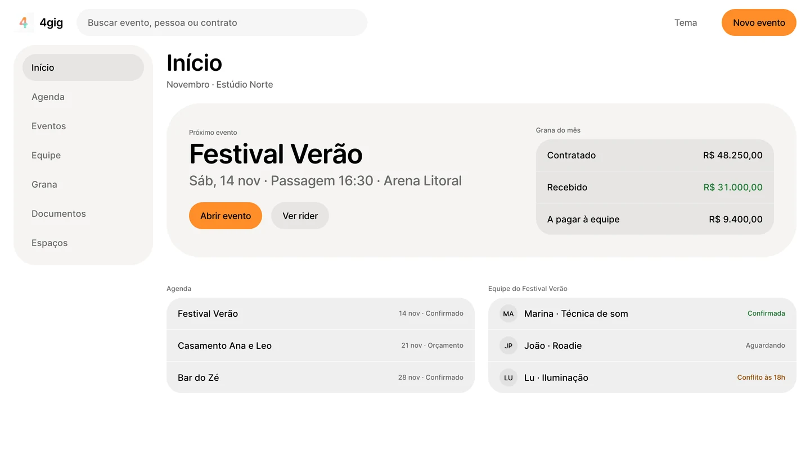
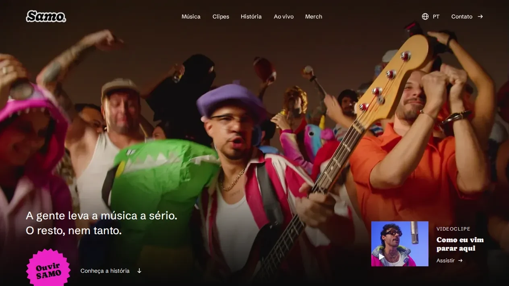

### Rafael Teixeira

English · [Português](README.pt-BR.md)

Software developer in Florianópolis, Brazil, moving into AI engineering.

I spent six years in technical support learning how software breaks in production: reading logs, reproducing bugs, querying databases and turning a customer's complaint into something an engineer can fix. Now I build the other side. I write web and mobile apps, wire AI features and MCP servers into them, and evaluate LLM responses for a living. The question I keep coming back to is how to let a model help without letting it decide what it shouldn't.

**Now**

- AI Quality Analyst (contract, since Apr 2026): I evaluate LLM responses in English and Portuguese for factual accuracy, grounding in sources and instruction following.
- Independent software engineer (since Mar 2025): requirements to deploy for client apps in TypeScript, React, Next.js, React Native, Swift, Node.js, Python and PostgreSQL, with AI SDKs and MCP servers. I also design the interfaces and the design systems behind them.
- Studying Systems Analysis and Development at Universidade Cruzeiro do Sul (graduating Nov 2027).

**Before**

- Support Engineer at [Involves](https://www.involves.com) (2021–2025): the go-to person for API and mobile escalations on a 15-person support team for a trade-marketing SaaS used across Latin America. I rewrote the docs for 40+ API endpoints and wrote a Python tool to fix the generated OpenAPI spec. Two CX Awards (Q3 and Q4 2022).
- Technical support at TIVIT (payments API, PostgreSQL), Softplan (court-case management, Oracle/DB2/SQL Server) and Modula Software (2019–2021).

**Selected work**

| Project | What it is |
| --- | --- |
| [support-investigator](https://github.com/rafactx/support-investigator) | An AI support investigator where the model only proposes and a deterministic policy decides. MCP server, typed evidence ledger, intake evals and prompt-injection tests in CI. Cloudflare Workers, D1, Workers AI. [Live demo](https://support-investigator.rafactx.workers.dev) |
| 4gig design system | The design system for 4gig, an app for bands and production crews to run shows, teams and money. One `DESIGN.md` holds the tokens and the rules and ships as a skill for coding agents; CI fails when the CSS or the generated tokens drift from it. Shadcn on Base UI, light and dark. Private repo, screenshot below. |
| [samo.band](https://samo.band) | Site for the Brazilian hip-hop band SAMO: 36 pages in six languages, static Astro on a Cloudflare Worker, with accessibility, visual and byte-budget checks before every merge. |
| [api-docs-starter](https://github.com/rafactx/api-docs-starter) | API documentation starter with VitePress, Vue 3 and Scalar, in four languages. [Live demo](https://api-docs-starter.rafactx.workers.dev) |
| [openapi-fixer-v2](https://github.com/rafactx/openapi-fixer-v2) | Python pipeline that enriches, repairs and validates a generated OpenAPI spec, with end-to-end tests. |

  <picture><source media="(prefers-color-scheme: dark)" srcset="assets/4gig-dark.webp"></picture>
  

Open source: [Icon Composer app icon for metria](https://github.com/yurirxmos/metria/pull/3) (merged).

**Elsewhere** · [LinkedIn](https://www.linkedin.com/in/hi-im-rafael-teixeira) · Anthropic *Claude Code in Action* certificate · English C2 (EF SET 72/100)
