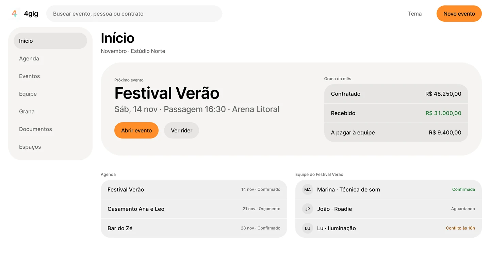
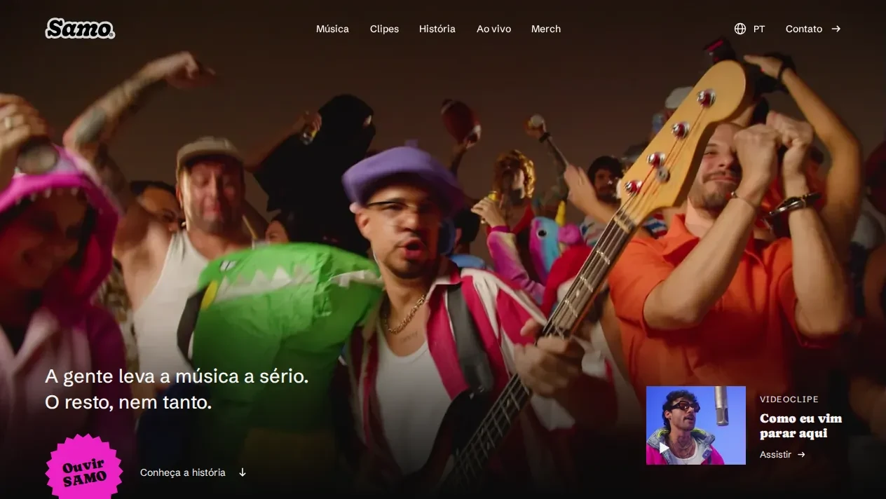

### Rafael Teixeira

[English](README.md) · Português

Desenvolvedor de software em Florianópolis, migrando para AI engineering.

Passei seis anos em suporte técnico aprendendo como o software quebra em produção: lendo logs, reproduzindo bugs, consultando bancos de dados e transformando a reclamação de um cliente em algo que um engenheiro consegue corrigir. Agora construo o outro lado. Escrevo apps web e mobile, integro recursos de IA e servidores MCP neles, e avalio respostas de LLM profissionalmente. A pergunta à qual sempre volto é como deixar um modelo ajudar sem deixá-lo decidir o que não deve.

**Agora**

- AI Quality Analyst (contrato, desde abr 2026): avalio respostas de LLM em inglês e português quanto à precisão factual, à fundamentação nas fontes e ao cumprimento de instruções.
- Engenheiro de software independente (desde mar 2025): dos requisitos ao deploy de apps para clientes em TypeScript, React, Next.js, React Native, Swift, Node.js, Python e PostgreSQL, com SDKs de IA e servidores MCP. Também desenho as interfaces e os design systems por trás delas.
- Cursando Análise e Desenvolvimento de Sistemas na Universidade Cruzeiro do Sul (formatura em nov 2027).

**Antes**

- Support Engineer na [Involves](https://www.involves.com) (2021–2025): referência em escalações de API e mobile num time de suporte de 15 pessoas, num SaaS de trade marketing usado em toda a América Latina. Reescrevi a documentação de mais de 40 endpoints da API e escrevi uma ferramenta em Python para corrigir a especificação OpenAPI gerada. Dois CX Awards (3º e 4º tri de 2022).
- Suporte técnico na TIVIT (API de pagamentos, PostgreSQL), na Softplan (gestão de processos judiciais, Oracle/DB2/SQL Server) e na Modula Software (2019–2021).

**Trabalhos selecionados**

| Projeto | O que é |
| --- | --- |
| [support-investigator](https://github.com/rafactx/support-investigator) | Um investigador de suporte com IA em que o modelo só propõe e uma política determinística decide. Servidor MCP, registro tipado de evidências, evals de triagem e testes de prompt injection no CI. Cloudflare Workers, D1, Workers AI. [Demo no ar](https://support-investigator.rafactx.workers.dev) |
| Design system do 4gig | O design system do 4gig, um app para bandas e equipes de produção cuidarem de shows, equipe e dinheiro. Um `DESIGN.md` guarda os tokens e as regras e vira skill para agentes de código; o CI falha quando o CSS ou os tokens gerados se afastam dele. Shadcn sobre Base UI, claro e escuro. Repositório privado, print abaixo. |
| [samo.band](https://samo.band) | Site da banda de hip-hop SAMO: 36 páginas em seis idiomas, Astro estático num Cloudflare Worker, com testes de acessibilidade, visuais e de orçamento de bytes antes de cada merge. |
| [api-docs-starter](https://github.com/rafactx/api-docs-starter) | Starter de documentação de API com VitePress, Vue 3 e Scalar, em quatro idiomas. [Demo no ar](https://api-docs-starter.rafactx.workers.dev) |
| [openapi-fixer-v2](https://github.com/rafactx/openapi-fixer-v2) | Pipeline em Python que enriquece, corrige e valida uma especificação OpenAPI gerada, com testes de ponta a ponta. |

  <picture><source media="(prefers-color-scheme: dark)" srcset="assets/4gig-dark.webp"></picture>
  

Open source: [ícone do app metria no Icon Composer](https://github.com/yurirxmos/metria/pull/3) (merged).

**Em outros lugares** · [LinkedIn](https://www.linkedin.com/in/hi-im-rafael-teixeira) · Certificado *Claude Code in Action* da Anthropic · Inglês C2 (EF SET 72/100)
